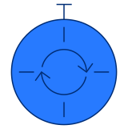
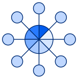
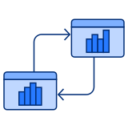
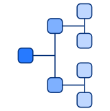

# Дар бораи Giga Meter

### Дар бораи Giga

Giga ташаббуси UNICEF–ITU барои пайваст кардани ҳар як мактаб ба интернет аст. Giga технологияҳои дорои матнҳои кушодаро таҳия ва нигоҳдорӣ мекунад, ки ба ҳукуматҳо дар банақшагирӣ, роҳандозӣ ва таъмини устувори пайвастшавии мактабҳо ба интернет ёрӣ мерасонад.

***



### Giga Meter чист?

Giga Meter барномаи компютерии дорои матнҳои кушода аст, ки сифати пайвастшавии мактабҳоро ба интернет чен мекунад. Он ҳамарӯза ба таври худкор санҷишҳо гузаронида, натиҷаҳоро дар тӯли замон сабт ва бо [Giga Maps](https://maps.giga.global/) - харитаи умумии мактабҳо ва ҳолати пайвастшавии онҳо - ҳамоҳанг месозад.

Ин маълумот ба ҳукуматҳо ва маъмурони мактабҳо имкон медиҳад, ки бубинанд, пайвастшавӣ дар куҷо нокифоя аст ва куҷо ба сармоягузорӣ ва дастгирӣ ниёз дорад.

Giga Meter соли 2023 аз ҷониби Giga дар ҳамкорӣ бо ширкати Ericsson таҳия шудааст.

### Чаро бояд аз Giga Meter истифода кард?

Пайвастшавие ки чен карда мешавад, имкони маблағгузорӣ, пайваста такмил ва бехатар шуданро дорад, инчунин дар тӯли замон пайгирӣ карда шавад. Giga Meter андозагириро имконпазир мекунад.



<figure><figcaption></figcaption></figure>





<figure><figcaption></figcaption></figure>

**Андозагирии худкор**

Барномаи Windows дар замина бо ҳадди ақали ҷалби корбар ва бо сарфи ками интернет кор мекунад.



<figure><figcaption></figcaption></figure>

**Мониторинги пайвастшавӣ**

Мактабҳоеро муайян мекунад, ки ба меъёр ё стандартҳои пайвастшавӣ ҷавобгӯ нестанд.



<figure><figcaption></figcaption></figure>

**Маълумот барои банақшагирӣ**

Маълумот дар бораи нишондиҳандаҳои фаъолият дар тӯли замон барои банақшагирии пайвастшавӣ ба интернет мусоидат мекунад.



***

### Ин барои шумо чӣ маъно дорад?



<figure><figcaption></figcaption></figure>

Giga Meter дар бораи сатҳи пайвастшавии мактабҳо ба интернет маълумоти мунтазам ва муқоисашаванда пешниҳод мекунад. Ин ба роҳбарони лоиҳаҳои таъмини интернет имкон медиҳад, ки барои қабули қарорҳо аз заминаи ягонаи далелу маълумот истифода кунанд.

Андозагириҳои анҷомшуда дар мактабҳои деҳот ва минтақаҳои ба хидматрасониҳо камтартаъминшуда барои муайян кардани самтҳои афзалиятноки сармоягузорӣ ба инфрасохтор мусоидат мекунад, то маблағгузорӣ ба ҷойҳое равона шавад, ки воқеан ба он ниёз доранд, на танҳо ба минтақаҳое ки дастрасӣ ба онҳо осонтар аст.

Мониторинги доимӣ нишон медиҳад, ки оё тадбирҳои андешидашуда натиҷа медиҳанд ва дар кадом самтҳо зарурати бозбиниву ислоҳи нақшаҳо вуҷуд дорад.



<figure><figcaption></figcaption></figure>

Мушкилоти пайвастшавӣ дар мактабҳои деҳот ва минтақаҳои ба хидматрасониҳо камтартаъминшуда сабт ва зоҳир карда мешавад. Ин ба ҳукуматҳо ва шарикон имкон медиҳад, ки дастгирии худро ба самтҳои афзалиятнок равона созанд.&#x20;

Маълумоти андозагирии солҳои сипаришуда метавонад барои асоснок кардани дархостҳо дар мавриди беҳтар кардани интернет, таъмини таҷҳизот ё маблағгузорӣ истифода шаванд.

Маълумот на танҳо нишон медиҳад, ки мактаб ба интернет пайваст аст ё не, балки муайян мекунад, ки суръат ва устувории пайвастшавӣ барои омӯзиши рақамӣ то чӣ андоза кофӣ мебошад. Илова бар ин, он барои ошкор кардани ҳолатҳои ғайримуқаррарӣ, монанди коҳиши суръати интернет, пеш аз он ки ба раванди дарсҳо халал расонад, мусоидат мекунад.



<figure><figcaption></figcaption></figure>

Giga Meter барои муайян кардани инки оё интернети мактаб барои истифодаи абзорҳои рақамӣ, платформаҳои онлайнӣ ва омӯзиш дар синфхонаҳо ба қадри кофӣ устувор аст ё не, мусоидат мекунад.

Ин арзёбиҳо имкон медиҳанд, хонандаҳое ки бештар ба дастгирӣ ниёз доранд, воқеан онро ба даст биёваранд.


