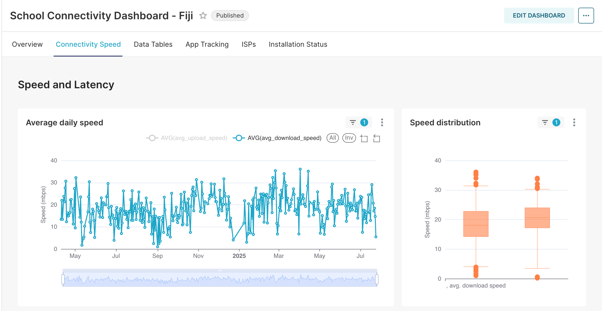

# Омӯзиши ҳолатҳо

Ҳукуматҳо маълумоти Giga Meter-ро барои қабули қарорҳо чӣ гуна истифода мебаранд. Ҳар лоиҳаи дар поён овардашуда бо муайян кардани  ҳадафи мушаххас оғоз шудааст: яъне муайян кардани қароре, ки бояд дар асоси маълумоти ҷамъоваришуда қабул карда шавад.

← [Роҳнамои ҳамроҳшавии ҳукуматҳо](https://app.gitbook.com/o/8BQfV8Vqh6wiOaWogeSs/sites/site_HGoWY/s/nO4TCnw5Pvr77OIRKx3h/country-deployment/government-onboarding-overview)

***

### Шарҳи мухтасари вазъи кишварҳо

| **Кишвар**                               | **Ҳадафи асосӣ**                                                                                                                                                                    | **Меъёри муқоисавӣ**                                        | **Модели татбиқ**                                    |
| ---------------------------------------- | ----------------------------------------------------------------------------------------------------------------------------------------------------------------------------------- | ----------------------------------------------------------- | ---------------------------------------------------- |
| 🇧🇷 Бразилия                            | Таъмини риояи меъёрҳои суръати интернет барои ҳар як мактаб ва санҷиши иҷрои уҳдадориҳои молиявии провайдерҳо (ISP)                                                                 | 1 Мбит/с барои ҳар як хонанда дар басти серхонандатарин     | Омехта                                               |
| 🇧🇼 Ботсвана                            | 

Назорати риояи талаботи миллӣ оид ба пайвастшавии мактабҳо ба интернет
                                                                                                | 100 Mbps                                                    | Фосилавӣ (дастаи мутамаркази дастгирӣ)               |
| 🇲🇳 Муғулистон                          | Беҳтар кардани кори шабакаи маҳаллии компютерӣ (LAN) ва фароҳам овардани шароит барои бастани шартнома бо провайдерҳо дар сатҳи маҳаллӣ                                             | Меъёри ҳадди ақали расмӣ муқаррар нашудааст                 | 

Фосилавӣ (дастаи мутамаркази дастгирӣ)
 |
| 🇫🇯 Фиҷӣ                                | Муайян кардани мактабҳое, ки барои баргузории дарсҳои мустақими фанҳои STEM (илм, технология, муҳандисӣ ва математика) тавассути пахши мустақим пайвасти боэътимоди интернет доранд | Меъёри ҳадди ақали расмӣ муқаррар нашудааст                 | Омехта                                               |
| 

🇧🇦 Босния ва Ҳерсеговина
 | Муайян кардани мактабҳое, ки ба меъёрҳои татбиқи барномаҳои таълими рақамӣ ҷавобгӯ мебошанд                                                                                         | 

Пайвастшавии босифат ва самаранок ба интернет
 | Омехта                                               |
| 🇱🇰 Шри-Ланка                           | Муайян кардани нишондиҳандаи ибтидоии миллии пайвастшавӣ ба интернет, бо оғози кор аз вилояти Шарқӣ                                                                                 | Меъёри ҳадди ақали расмӣ муқаррар нашудааст                 | Омехта (омӯзишҳо дар сатҳи вилоят)                   |
| 🇳🇦 Намибия                             | Ҷамъоварии далелҳо барои қабули қарорҳо оид ба хариди таҷҳизот ва хизматрасониҳо                                                                                                    | То соли 2030 - таъмини 100%-и мактабҳо бо суръати 1 Гбит/с  | Омехта                                               |

***

### Татбиқи сиёсат

<strong>🇧🇷 Бразилия - назорати риояи меъёрҳои суръати интернет ва маблағгузории ISP аз рӯи натиҷаҳои воқеӣ</strong>

#### Бразилия

**Замина**: Шӯрои миллии мактабҳои пайвастшудаи Бразилия (ENEC) ҳадафи 1 Мбит/с барои як хонандаи сабтиномшударо дар басти серодамтарини мактаб муқаррар мекунад. Бо садҳо ҳазор мактаб, санҷиши дастӣ мутобиқат имконнопазир аст.

**Ҳолати истифода**: Маълумоти SIMET дар вақти воқеӣ (монанд ба Giga Meter) ба ҳукумати федералӣ имкон медиҳад, ки назорат кунад, ки кадом мактабҳо ба меъёр пайваста мувофиқат мекунанд, на танҳо ҳангоми имзои шартнома. Ҳамин маълумот фаъолияти ISP-ро тибқи имтиёзи молиявии FUST тасдиқ мекунад, ки ба ISP имкон медиҳад, ки ӯҳдадориҳои Фонди хидматрасонии универсалии худро тавассути таъмини пайвасти баландсуръати ченшуда ба мактабҳо ба ҷои пардохт ба фонди марказӣ иҷро кунад.

**Қарор қабул шуд**: Мактабҳое, ки аз ҳадди ниҳоии як хонанда камтаранд, барои пайгирии ISP қайд карда мешаванд.

**Чӣ ин моделро амалӣ мекунад**: Меъёр ба мактаб хос аст: он бо сабти ном (ё шумораи кормандон барои мактабҳои томактабӣ) миқёс мегирад, на бо шумораи муқарраршудаи Мбит/с. Ин барои ISP-ҳо иҷрои шартномаро душвортар мекунад, дар ҳоле ки ба мактабҳои калонтар хидмат намерасонанд.

<figure><figcaption></figcaption></figure>

<strong>🇧🇼 Ботсвана - мониторинги лоиҳаи “Пайвастшавии деҳот”</strong>

#### Ботсвана

**Замина**: Лоиҳаи пайвастшавии деҳоти Ботсвана ҳадафи пайваст кардани мактабҳоро ба стандарти 100 Мбит/с дорад. Бо пайваст шудани тақрибан 700 мактаб, ҳукумат ба роҳе ниёз дошт, ки тасдиқ кунад, ки стандарт дар амал, на танҳо дар рӯи коғаз, риоя мешавад.

**Ҳолати истифода**: Giga Meter дар баробари Passport Learning-и UNICEF, як платформаи мундариҷаи рақамӣ, ки ба донишҷӯён дастрасӣ ба маводи таълимиро дар офлайн ва онлайн медиҳад, ҷойгир карда шудааст. Ин ду барнома якҷоя ҷойгир карда мешаванд: Маълумоти Giga Meter ба ташаббуси мониторинги SmartBots-и ҳукумат ворид мешавад, то арзёбӣ кунад, ки оё мактабҳо ба меъёри 100 Мбит/с мувофиқат мекунанд, дар ҳоле ки Passport Learning аз воқеӣ ва устувор будани он пайвастшавӣ вобаста аст. Назорати пайвастшавӣ дар ин ҷо на танҳо ба риояи ISP дахл дорад; он шарти пешакии расонидани мундариҷаи рақамӣ ба донишҷӯён мебошад.

Модел берун аз мактабҳо то марказҳои саломатӣ ва иншооти ҷамъиятӣ васеъ карда мешавад, ки инфрасохтори пайвастшавӣ дар байни бахшҳо барои беҳтар кардани дастрасӣ муштарак аст.

**Модели ҷойгиркунӣ**: Дастаи дастгирии дурдаст ва марказонидашуда. Мактабҳо Giga Meter-ро мустақилона мувофиқи дастури насб насб мекунанд ва мизи дастгирии ҳукумат барои ҳалли мушкилот.

**Қарор қабул карда шуд**: Мактабҳое, ки пайваста камтар аз 100 Мбит/с суръат доранд, барои музокироти аз нав дида баромадани провайдери интернет ё банақшагирии навсозии инфрасохтор муайян карда шуданд. Ҷорӣ намудани Passport Learning мувофиқи тасдиқи пайвастшавӣ тартиб дода шудааст; мактабҳое, ки пайвасти тасдиқшуда надоранд, барои интиқоли мундариҷа фаъол карда намешаванд.

<figure><figcaption></figcaption></figure>

<strong>🇲🇳 Муғулистон - муқоисаи маълумоти шабакаи маҳаллӣ (LAN) ва ташкили низоми ғайримутамаркази бастани шартномаҳо бо провайдерҳои интернетӣ</strong>

#### Муғулистон

**Замина**: Маркази технологияҳои иттилоотии таълимии Муғулистон (EITC) фаъолияти интернетро дар мактабҳо тавассути LibreNMS дар роутерҳо ва нуқтаҳои дастрасӣ дар баробари Giga Meter дар дастгоҳҳои корбар назорат мекунад. Маълумот секунҷа карда мешавад, то муайян карда шавад, ки оё мушкилоти пайвастшавӣ дар сатҳи ISP, роутер ё нуқтаи дастрасии маҳаллӣ вуҷуд доранд.

**Ҳолати истифода**: Giga Meter қабати андозагирии дастгоҳи ниҳоиро фароҳам меорад, ки абзорҳои инфрасохторӣ (LibreNMS) наметавонанд онро ҳал кунанд. Дар маҷмӯъ, маълумот барои ҳалли мушкилот ва беҳтар кардани сифати таҷриба барои корбарони ниҳоӣ, аз ҷумла донишҷӯён ва муаллимон истифода мешавад.

Муғулистон инчунин ба шартномаҳои ғайримарказии пайвастшавӣ мегузарад, ки ба мактабҳо имкон медиҳад, ки мустақиман дар доираи Созишномаҳои сатҳи хидматрасонии стандартӣ бо ISP шартнома банданд. Маълумоти Giga Meter барои мактабҳо ва ҳамоҳангсозони минтақавӣ заминаи далелҳоро фароҳам меорад, то таҷрибаи корбарро бо сатҳи шартномавии ISP муқоиса кунанд.

**Қарор қабул шуд**: Мактабҳое, ки сарфи назар аз метрикаҳои солим дар роутер фаъолияти пасти дастгоҳи ниҳоиро доранд, барои тафтишоти тарафи ISP қайд карда мешаванд. Қарорҳои навсозии шартнома аз таърихи андозагирии сатҳи мактаб огоҳ карда мешаванд.

<figure><figcaption></figcaption></figure>

<figure><figcaption></figcaption></figure>

***

### Татбиқи барномаҳои таълими рақамӣ

<strong>🇫🇯 Фиҷӣ - муайян кардани мактабҳое ки  барои баргузории дарсҳои мустақими фанҳои STEM омодаанд</strong>

#### Фиҷӣ

**Замина**: Фиҷӣ дар ҷамоатҳои дурдасти ҷазираҳои худ бо норасоии муаллимони соҳибихтисоси STEM рӯбарӯ аст. Вазорати маориф барномаеро барои пахши мустақими дарсҳои STEM ба якчанд мактаб дар як вақт таҳия кардааст, ки танҳо барои мактабҳое, ки пайвасти боэътимод ва устувор доранд, кор мекунад.

**Ҳолати истифода**: Маълумоти Giga Meter муайян мекунад, ки кадом мактабҳо пайвасти кофӣ устувор доранд, то дарсҳои пахши мустақимро дастгирӣ кунанд. Мактабе, ки зуд-зуд аз даст медиҳад ё тағйирёбии баланд нишон медиҳад, наметавонад боэътимод иштирок кунад. Маълумот раванди интихобро бар асоси далелҳо мегардонад, на ба гузоришдиҳии худии мактаб ё иддаоҳои ISP такя мекунад.

**Қарор қабул шуд**: Танҳо мактабҳое, ки пайвасти боэътимоди тасдиқшуда дар тӯли давраи мониторинг дар барномаи дарси мустақим сабти ном шудаанд. Мактабҳои поёнтар аз ҳадди ниҳоӣ пеш аз сабти ном барои дастгирии инфрасохтор қайд карда мешаванд.

<figure><figcaption>
Масъули вазорат ба экрани калоне ишора мекунад, ки дар он «Giga Maps» бо маълумот дар бораи пайвасти мактабҳои Фиҷи ба шабака намоиш дода мешавад.
</figcaption></figure>

<figure><figcaption>
Панели иттилоотии пайвасти мактабҳо дар Фиҷӣ, ки суръати миёнаи рӯзона ва диаграммаҳои тақсимоти суръатро нишон медиҳад
</figcaption></figure>

<strong>🇧🇦 Босния ва Ҳерсеговина – арзёбии мутобиқати мактабҳо ба меъёрҳои пайвастшавии босифат ва самаранок ба интернет</strong>

#### Босния ва Ҳерсеговина


**Замина**: Барномаи таълими рақамӣ бояд пеш аз ҷойгиркунии мундариҷа ва дастгоҳҳо муайян мекард, ки кадом мактабҳо ба меъёри "пайвастагии пурмазмун" ҷавобгӯ мебошанд.


**Ҳолати истифода**: Маълумоти Giga Meter барои муқоисаи мактабҳо бо меъёри пайвасти пурмазмун, як меъёри мураккаб, ки суръати зеркашӣ, суръати боргузорӣ, таъхир ва вақти кориро якҷоя ба назар мегирад, истифода шуд. Мактабҳое, ки ба меъёр ҷавобгӯ набуданд, аз гурӯҳи ибтидоии барнома хориҷ карда шуданд ва барои дастгирии пайвастшавӣ қайд карда шуданд.


**Қарор қабул шуд**: Ҳуқуқи мактаб барои сабти ном дар барномаи таълими рақамӣ. Мактабҳое, ки аз меъёр поёнтар буданд, ба ҷараёни кории алоҳидаи дастгирии инфрасохтор равона карда шуданд.

***

### Нишондиҳандаҳои ибтидоӣ ва банақшагирӣ

<strong>🇱🇰 Шри-Ланка - аз муайян кардани нишондиҳандаи ибтидоӣ дар сатҳи вилоят то татбиқи барнома дар саросари кишвар</strong>

#### Шри-Ланка


Шри-Ланка ягон стандартикунонидашуда ва мустақилона тасдиқшудаи ибтидоии пайвастшавии мактабро надошт. Густариши миллии барномаҳои таълими рақамӣ донистани ҳолати воқеии пайвастшавиро талаб мекард, на посухҳои пурсишномаҳо ё сабтҳои ISP.

Giga Meter дар як марҳилаи гибридӣ ҷойгир карда шуд, ки аз мактабҳои вилояти Шарқӣ, ки тавассути семинарҳои минтақавӣ омӯзиш дидаанд, оғоз ёфт. Маълумот аз вилоят аввалин маълумоти ибтидоии боэътимоди пайвастшавии сатҳи мактабро барои огоҳ кардани банақшагирии миллӣ фароҳам овард. Ҳоло беш аз 500 мактаб дар харитаҳои Giga мавҷуданд. Дар саросари кишвар, тақрибан 30% аз тақрибан 10,000 мактаби кишвар дастрасӣ ба интернет доранд.

**Модели мактабҳои пайвастшуда**
\
Дар сафи пеши ҷойгиркунӣ дар Ампара, бузургтарин ноҳияи вилояти Шарқии Шри-Ланка, ки беш аз 150 км тӯл мекашад, **хонум С. Р. Ҳасанти**, директори минтақавии маориф қарор дорад. Вай моделеро дастгирӣ кард, ки мактабҳоро бо лабораторияҳои пурра муҷаҳҳази ТИК бо мактабҳое, ки захираҳои камтар доранд, пайваст мекунад ва синфхонаҳои виртуалиро фароҳам меорад, ки ба донишҷӯён новобаста аз макон дастрасӣ пайдо мекунанд. Як мактаби марказӣ, **Гамини Маҳа Видялая**, ҳоло 20 мактаби ба ҳам пайвастшударо дастгирӣ мекунад.

>
> "Ба шарофати пайвастшавӣ тавассути ин лабораторияҳои ТИК, донишҷӯён малакаҳои рақамиро инкишоф медиҳанд ва дониши худро берун аз синфхона васеъ мекунанд." - Хонум С. Р. Ҳасанти, директори минтақавии маориф, Ампара


Санҷишҳои автоматии ҳаррӯзаи Giga Meter заминаи заруриро барои Вазорати маориф фароҳам оварданд: на пурсиши якдафъаина, балки сабти пайвастаи пайвастшавӣ дар сатҳи мактаб. **Барномаи веби Sip Arana**, ки аз ҷониби муаллимони худи Ампара таҳия шудааст, аллакай ба 200 донишҷӯ бо варақаҳои кории ройгон дастрасӣ дорад. Маълумоти пайвастшавӣ нишон медиҳад, ки кадом мактабҳо метавонанд абзорҳои ба ин монандро дар ихтиёр дошта бошанд ва дастгирӣ кунанд.

> "Ҳар як мактаб сазовори дастрасӣ ба интернети босуръат ва боэътимод аст. Ҳар як кӯдак сазовори имконияти омӯхтан, рушд кардан, орзу кардан аст. Мактабҳои пайвастшуда ояндаи пайвастшударо эҷод мекунанд." - Хонум Ҳасанти

**Назари донишҷӯ**


Ҳаршанӣ хонандаи синфи 10-уми мактаби Бакмитиява Видялая дар деҳоти Ампара аст ва орзуи ҳуқуқшинос шуданро дошт:

>
> "Пеш аз он ки мактаби мо пайвастшавӣ надошт, ман ба дарахтон баромадам ва ҳатто ба анборҳо мерафтам, то сигналҳои қавитар гирам ва ба маълумот дастрасӣ пайдо кунам. Акнун, бо пайваст шудани мактабҳои бештар, ман умедворам, ки хонандагоне мисли ман метавонанд ҳамон имкониятҳоеро дошта бошанд, ки дар шаҳрҳо ҳастанд."


**Қарор қабул шуд**: Маълумоти ибтидоӣ барои муайян кардани он, ки кадом мактабҳо метавонанд барномасозии рақамиро дастгирӣ кунанд ва кадоме аз онҳо пеш аз ҷорӣ кардан ба сармоягузорӣ ниёз доранд, истифода шуд. Натиҷаҳои вилояти шарқӣ ба нақшаи васеъкунии миллӣ таъсир мерасонанд.

***

### Харид ва сармоягузорӣ

🇳🇦 Намибия – истифодаи далелҳо барои харидҳои марбут ба пайвастшавӣ ба интернет

#### Намибия

**Замина**: Ҳадафи миллии Намибия ин аст, ки то соли 2030 100% мактабҳо бо суръати 1 Гбит/с пайваст карда шаванд. Пеш аз гуфтушунид дар бораи шартномаҳои пайвастшавӣ дар миқёси калон, ҳукумат барои таҳкими музокироти харид ба маълумоти тасдиқшуда дар бораи фаъолияти ҷорӣ ниёз дошт.


**Ҳолати истифода**: Giga Meter маълумоти мустақили фаъолияти сатҳи мактабро барои гуфтушунидҳои харид пешниҳод мекунад ва рақамҳои гузоришшудаи ISP-ро бо андозагириҳои мустақилона тасдиқшуда иваз мекунад.


**Қарор қабул шуд**: Гурӯҳи харид бо маълумоти ибтидоии фаъолияти тасдиқшуда, таҳлили тафовут аз рӯи минтақа ва маълумоти тамоюлҳои таърихӣ ба гуфтушунид шурӯъ мекунад.

***

### Таҳияи сенарияи истифодаи маълумот барои кишвари худатон

Ҳар як лоиҳаи дар боло овардашуда аз муайян кардани се масъалаи одӣ оғоз шудааст: ин маълумот барои қабули кадом қарор истифода мешавад, кӣ ин қарорро қабул мекунад ва ин қарор дар кадом давра қабул карда мешавад?

→ [Роҳнамо барои роҳбари таҳлили маълумот - Қадами 1](file:///C:/o/8BQfV8Vqh6wiOaWogeSs/sites/site_HGoWY/s/nO4TCnw5Pvr77OIRKx3h/country-deployment/data-analysis-lead)

Ҳангоми муайян кардани сенарияи истифодаи маълумот барои кишвари худ, аз ҷадвали болои ин саҳифа ҳамчун намуна истифода баред. Агар ҳадафи кишвари шумо ба яке аз самтҳои дар боло зикршуда мувофиқат кунад, метавонед таҳқиқоти мавриди дахлдорро ҳамчун қолаби ибтидоӣ истифода бурда, ба шароити кишвари худ мутобиқ созед.
